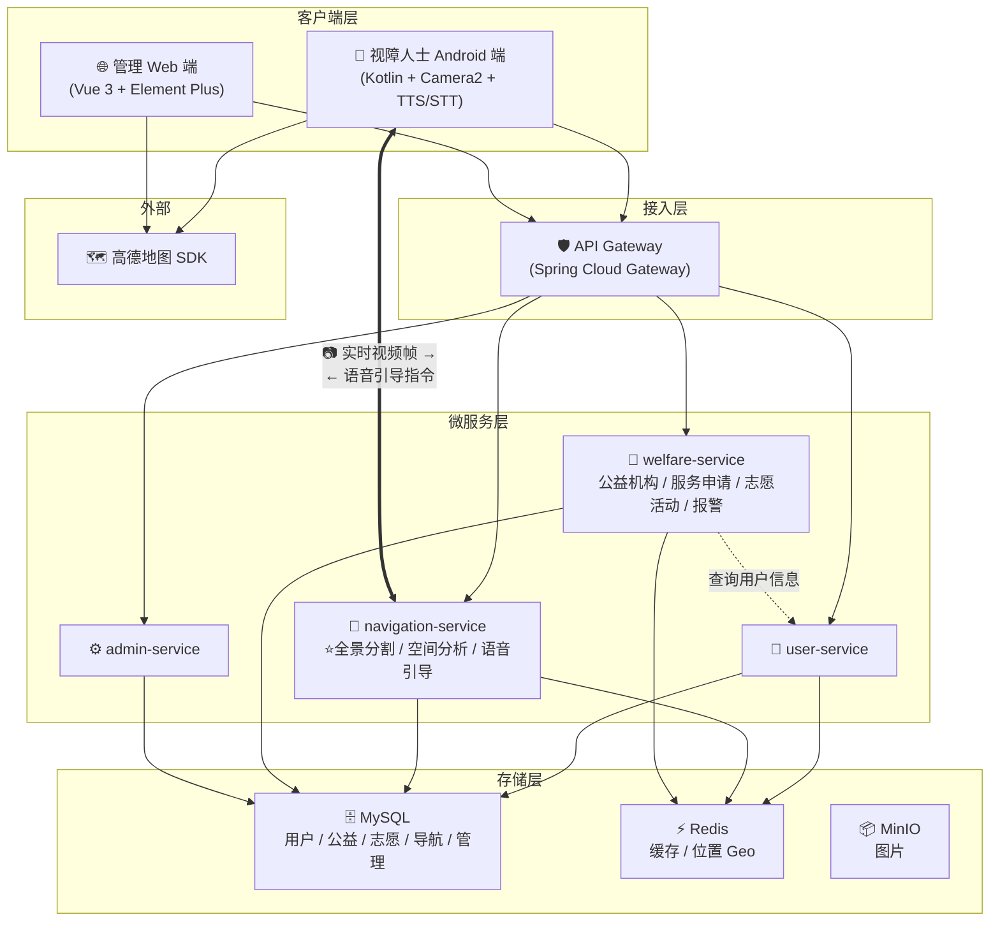
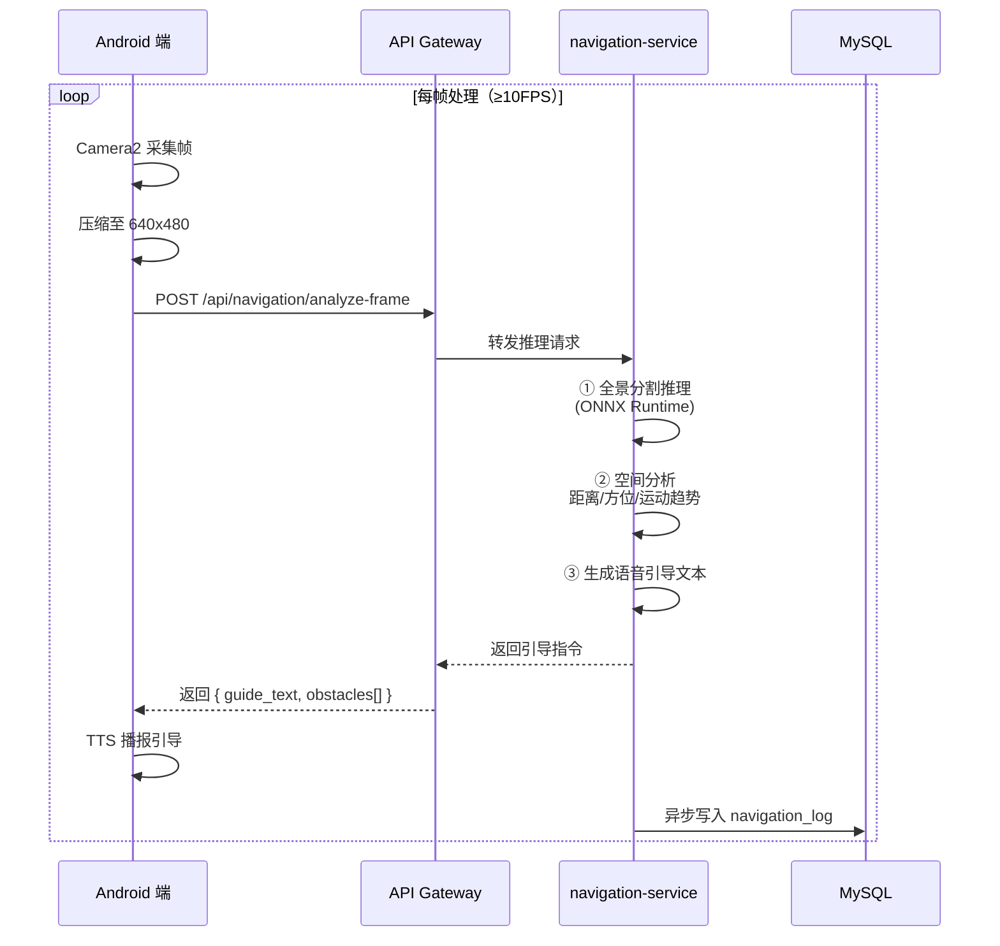
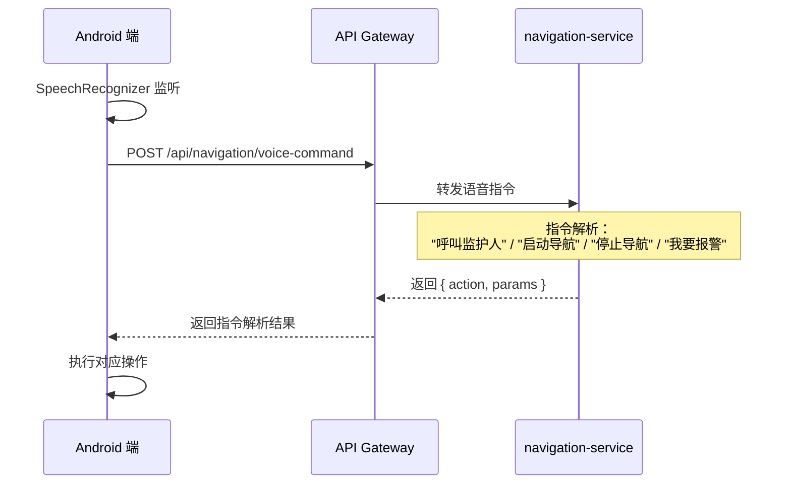
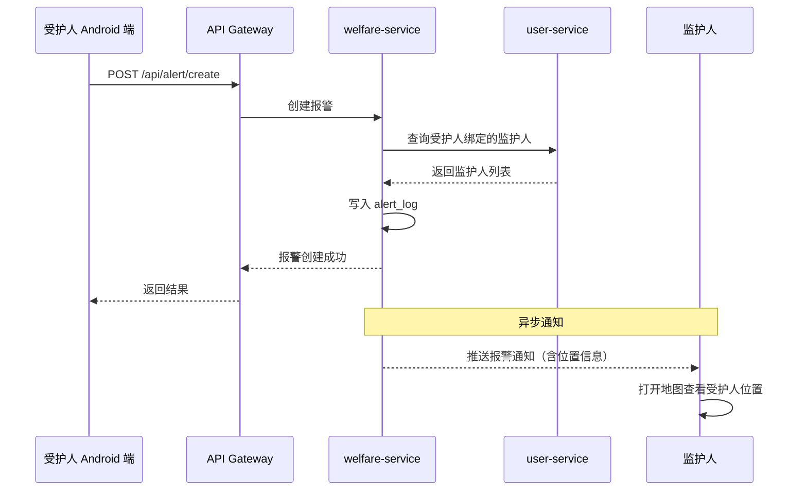
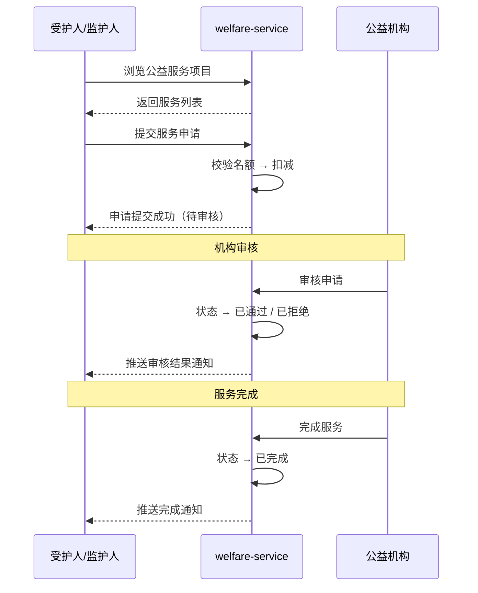
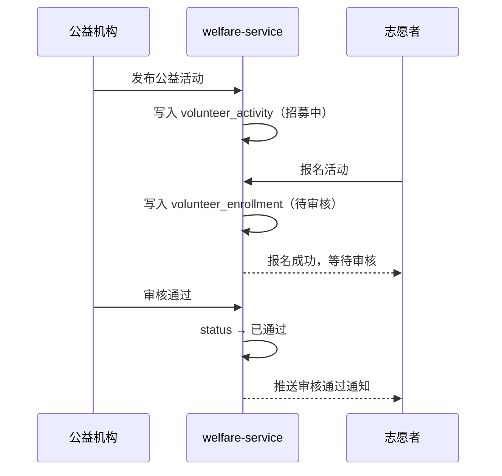

# SullivanMINI —— 视障公益服务平台 · 信息流图

---

## 一、系统总体信息流



---

## 二、核心业务信息流详解

### 2.1 ⭐ 全景分割视觉辅助出行



### 2.2 语音指令控制



### 2.3 安全报警 → 通知监护人



### 2.4 公益服务申请流程



### 2.5 公益活动 → 报名 → 审核



---

## 三、数据存储映射

| 业务数据 | 存储位置 | 读写模式 | 说明 |
|---------|---------|---------|------|
| 用户账户/资料 | MySQL | 频繁读写 | user-service 独享 |
| 公益机构信息 | MySQL | 中等频率 | welfare-service 独享 |
| 公益服务项目 | MySQL | 读多写少 | 受护人浏览为主 |
| 服务申请 | MySQL | 写入 + 查询 | 申请→审核→完成闭环 |
| 志愿活动 | MySQL | 中等频率 | 读写均衡 |
| 报警记录 | MySQL | 追加写入 | 只读历史 |
| 通知记录 | MySQL | 写入 + 按用户拉取 | 站内通知 |
| 导航日志 | MySQL | 追加写入 | 统计分析 |
| 模型配置 | MySQL | 极少写入 | 启动时加载 |
| JWT 会话 | Redis | 高速读写 | 过期自动淘汰 |
| 位置数据 | Redis Geo | 频繁写入 + 地理查询 | 实时位置 |

---

## 四、Android 端页面结构

```
┌──────────────────────────────────────┐
│          主页面（导航模式）             │
│  ┌────────────────────────────────┐  │
│  │                                │  │
│  │      摄像头实时预览（背景层）     │  │
│  │                                │  │
│  │     [障碍物标注覆盖层]           │  │
│  │                                │  │
│  │ "前方 2 米有台阶" ← TTS 播报   │  │
│  │                                │  │
│  └────────────────────────────────┘  │
│  ┌───────────┐  ┌────────────────┐  │
│  │ 🎤 语音   │  │ 🆘 求助报警    │  │
│  │  指令      │  │               │  │
│  └───────────┘  └────────────────┘  │
└──────────────────────────────────────┘

        ┌─────── 侧边菜单 ───────┐
        │  👤 个人信息            │
        │  📍 我的位置            │
        │  🤝 公益服务            │
        │  📢 志愿活动            │
        │  🔔 通知中心            │
        │  ⚙️ 设置               │
        └─────────────────────────┘
```

```
┌──────────────────────────────────────┐
│        Vue 管理后台页面结构            │
├──────────────────────────────────────┤
│  导航： Dashboard | 用户 | 机构       │
│          服务 | 活动 | 报警 | 审核     │
├──────────────────────────────────────┤
│                                      │
│           内容区（路由切换）            │
│                                      │
│  - 📊 运营总览（ECharts 图表）        │
│  - 👥 用户管理（受护人/监护人/志愿者） │
│  - 🏢 公益机构管理 + 审核            │
│  - 🎁 公益服务项目管理                │
│  - 📋 服务申请处理                    │
│  - 📢 公益活动管理                    │
│  - 🆘 报警记录查看                    │
└──────────────────────────────────────┘
```

---

## 五、角色-权限矩阵

| 功能模块 | 受护人 | 监护人 | 志愿者 | 机构 | 管理员 |
|---------|--------|--------|--------|------|--------|
| 全景分割导航 | ✅ | ❌ | ❌ | ❌ | ❌ |
| 语音指令控制 | ✅ | ❌ | ❌ | ❌ | ❌ |
| 位置上报 | ✅ | ❌ | ❌ | ❌ | ❌ |
| 查看受护人位置 | ❌ | ✅ | ❌ | ❌ | ❌ |
| 绑定受护人 | ❌ | ✅ | ❌ | ❌ | ❌ |
| 安全报警 | ✅ | ❌ | ❌ | ❌ | ❌ |
| 接收报警 | ❌ | ✅ | ✅ | ❌ | ❌ |
| 公益服务申请 | ✅ | ✅ | ❌ | ❌ | ❌ |
| 发布服务项目 | ❌ | ❌ | ❌ | ✅ | ❌ |
| 处理服务申请 | ❌ | ❌ | ❌ | ✅ | ❌ |
| 公益活动报名 | ❌ | ❌ | ✅ | ❌ | ❌ |
| 发布公益活动 | ❌ | ❌ | ❌ | ✅ | ❌ |
| 审核志愿者 | ❌ | ❌ | ❌ | ✅ | ❌ |
| 机构审核 | ❌ | ❌ | ❌ | ❌ | ✅ |
| 运营数据查看 | ❌ | ❌ | ❌ | ❌ | ✅ |
