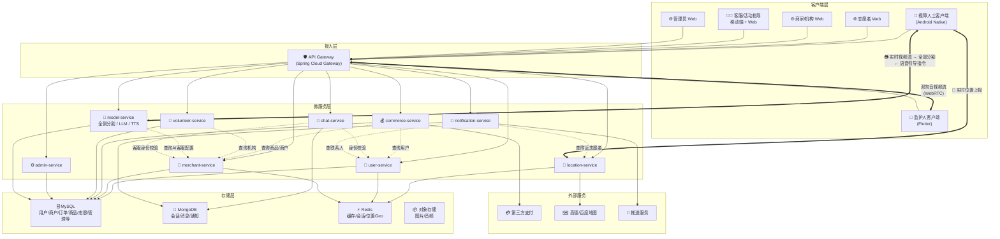
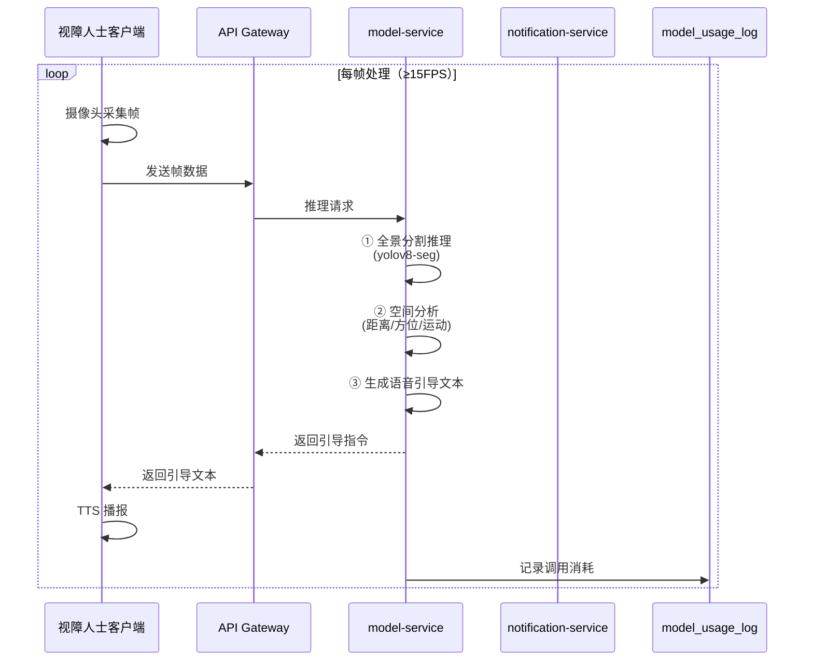
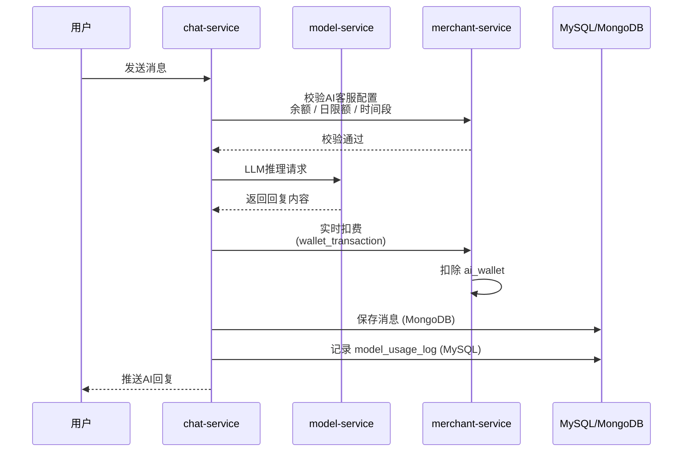
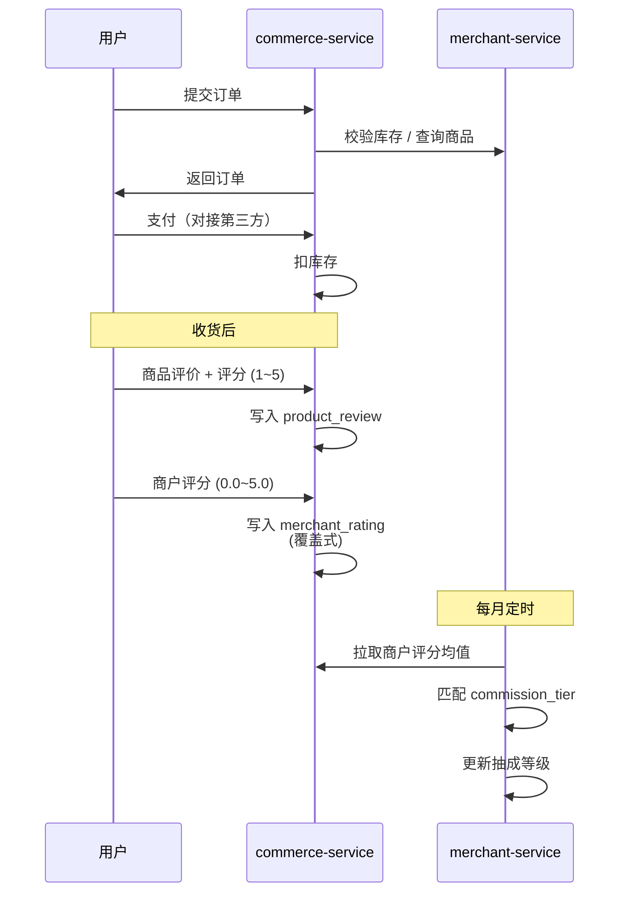
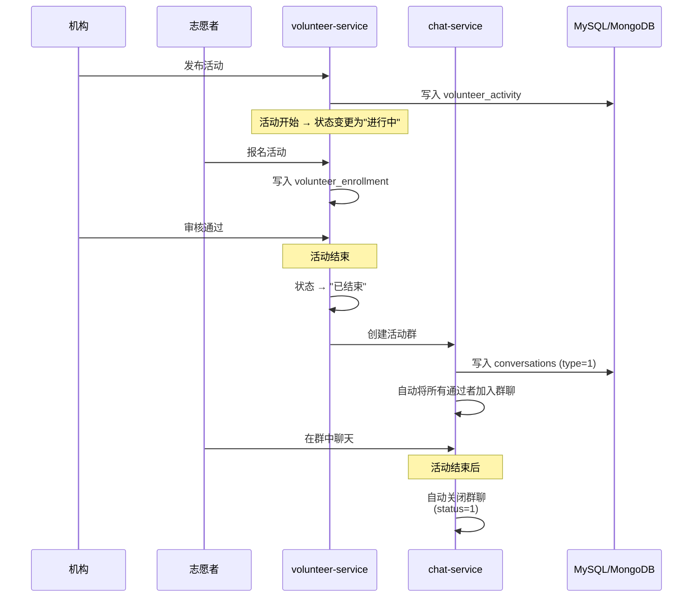
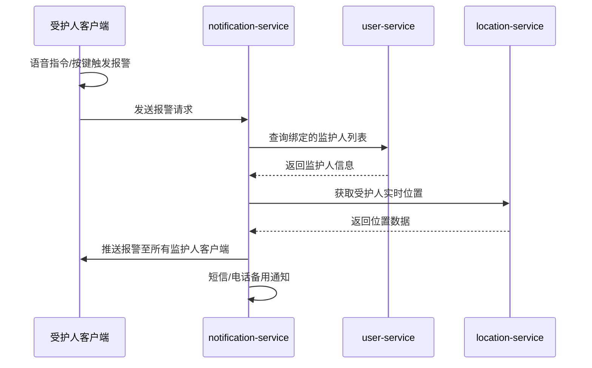

# Sullivan —— 视障服务连接平台 · 信息流图

---

## 一、系统总体信息流

---

## 二、核心业务信息流详解

### 2.1 ⭐ 核心创新：全景分割视觉辅助出行

---

### 2.2 AI客服对话 + 实时扣费

---

### 2.3 用户下单 → 评价 → 商户评分

---

### 2.4 志愿活动发布 → 报名 → 活动群

---

### 2.5 安全报警 → 通知监护人

---

## 三、数据存储映射

| 业务数据 | 存储位置 | 读写模式 | 说明 |
|---------|---------|---------|------|
| 用户账户/资料 | MySQL | 频繁读写 | 关系型，ACID |
| 商户/机构/商品 | MySQL | 频繁读写 | 关系型，事务保证 |
| 订单/交易流水 | MySQL | 频繁写入 + 查询 | 事务核心 |
| 模型调用记录 | MySQL | 追加写入 + 统计分析 | 定时归档 |
| 钱包流水 | MySQL | 顺序写入 + 实时查询 | 资金安全要求高 |
| 会话/消息 | MongoDB | 高并发写入 + 按会话查询 | 文档模型，无 schema 约束 |
| 通知记录 | MongoDB | 写入 + 按接收方拉取 | 结构灵活，read_by 数组 |
| 会话缓存 | Redis | 高速读写 | Token 缓存 |
| 位置数据 | Redis Geo | 写入 + 地理范围查询 | 就近匹配 |
| 商品图片 | 对象存储 (OSS/MinIO) | 上传 + CDN 分发 | 静态文件 |
