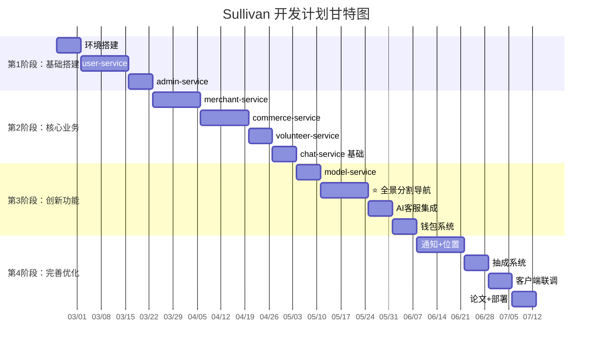

# Sullivan —— 视障服务连接平台 · 项目概述与开发计划

---

## 第一部分：项目简要概述

### 1.1 项目背景

我国有约 1700 万视障人士，他们在日常生活中面临出行难、购物难、获取服务难等诸多挑战。与此同时，现有的助盲产品往往功能单一——要么只提供出行辅助，要么只提供电商购物，缺乏一个整合多方资源、连接受护人、监护人、志愿者、商户/机构的综合性服务平台。

### 1.2 项目名称

**Sullivan** —— 取自海伦·凯勒的启蒙老师 Anne Sullivan，寓意技术充当视障人士的"引路人"。

**中文全称**：视障服务连接平台

### 1.3 项目定位

一个以 **全景分割视觉辅助出行** 为核心创新、覆盖视障人士日常生活所需的多角色服务平台。平台连接以下几类用户：

| 角色 | 数量预期 | 核心诉求 |
|------|---------|---------|
| 受护人（视障人士） | 核心用户 | 安全出行、语音控制、紧急求助、购物 |
| 监护人 | 与受护人绑定 | 实时查看位置、视频通话、接收报警、代购 |
| 志愿者 | 注册参与 | 报名志愿活动、接收求助广播 |
| 商户 | 服务提供方 | 商品上架销售、AI客服、评价管理 |
| 机构（导盲犬/康复/慈善） | 服务提供方 | 发布活动、审核志愿者 |
| **客服/活动指导** | **服务执行方** | **客服对话、AI客服辅助、活动指导、群聊管理** |
| 管理员 | 运营方 | 用户管理、审核、运营统计 |

### 1.4 核心创新功能

**全景分割视觉辅助出行**：通过受护人端摄像头实时采集画面，利用全景分割模型对环境中的障碍物进行像素级识别，结合空间分析与语音合成，以自然语言实时指导视障人士安全出行。

> 技术链路：摄像头帧采集 → 全景分割（yolov8-seg）→ 障碍物空间分析 → 语音引导生成 → TTS 播报

### 1.5 核心业务流程

```
受护人 ──┬── 全景分割导航 ───────→ model-service
          ├── 语音指令控制 ───────→ model-service
          ├── 安全报警 ──────────→ notification-service → 监护人
          ├── 视频通话 ──────────→ 监护人
          ├── 在线购物 ──────────→ commerce-service → 商户
          └── 查找志愿者 ────────→ location-service → 志愿者

监护人 ──┬── 查看受护人位置 ───→ location-service
          ├── 接收报警 ────────→ notification-service
          ├── 视频通话 ────────→ 受护人
          └── 商品购买/评价 ───→ commerce-service

志愿者 ──┬── 报名活动 ─────────→ volunteer-service → 机构
          ├── 接收求助广播 ────→ notification-service
          └── 参与群聊 ────────→ chat-service

商户 ────┬── 商品管理 ─────────→ merchant-service
          ├── AI客服配置 ──────→ merchant-service + model-service
          ├── 订单处理 ────────→ commerce-service
          └── 钱包充值 ────────→ merchant-service → 支付

机构 ────┬── 发布活动 ─────────→ volunteer-service
          └── 审核志愿者 ──────→ volunteer-service

客服/活动指导 ──┬── 客服对话 ─────────→ chat-service
                ├── 活动指导 ─────────→ volunteer-service
                └── 群聊管理 ─────────→ chat-service
```

### 1.6 技术架构概览

| 层次 | 技术方案 |
|------|---------|
| 视障人士客户端 | Android Native（Kotlin） |
| 监护人客户端 | Flutter |
| Web 端 | Vue 3 + Element Plus |
| 后端架构 | Spring Cloud Alibaba 微服务 |
| 数据库 | MySQL + MongoDB + Redis |
| 模型推理 | model-service（GPU 加速） |

---

## 第二部分：开发计划设计

### 2.1 总体阶段划分

```
第1阶段（基础搭建）── 第2阶段（核心业务）── 第3阶段（创新功能）── 第4阶段（完善优化）
     Week 1-4           Week 5-10           Week 11-14          Week 15-18
```

### 2.2 详细阶段计划

#### 第1阶段：基础搭建（第1-4周）

**目标**：搭建微服务基础架构，完成用户系统

| 周次 | 任务 | 产出 |
|------|------|------|
| 第1周 | 环境搭建：Nacos、Gateway、MySQL、MongoDB、Redis 部署 | 开发环境就绪 |
| 第2周 | user-service 实现：用户注册/登录、JWT 签发 | 用户 API |
| 第3周 | user-service：监护人/受护人/志愿者 CRUD、绑定关系 | 用户管理 API |
| 第4周 | admin-service：管理员 CRUD、权限管理 | 管理员 API |

**里程碑 M1（第4周末）：** 用户系统可用，支持三类用户注册登录与管理

---

#### 第2阶段：核心业务（第5-10周）

**目标**：完成商户/机构、商品、订单、志愿活动等核心业务

| 周次 | 任务 | 产出 |
|------|------|------|
| 第5周 | merchant-service：商户/机构注册、认证、类型管理 | 商户 API |
| 第6周 | merchant-service：商品 CRUD、上下架、定时下架、导盲犬管理 | 商品 API |
| 第7周 | commerce-service：订单、购物车、支付对接 | 订单 API |
| 第8周 | commerce-service：商品评价、商户评分 | 评价 API |
| 第9周 | volunteer-service：志愿活动发布、报名、审核 | 志愿 API |
| 第10周 | 服务人员管理、chat-service：客服对话基础 | 聊天 API |

**里程碑 M2（第10周末）：** 核心业务闭环可用，支持浏览、下单、评价、志愿活动

---

#### 第3阶段：创新功能 + AI 集成（第11-14周）

**目标**：实现全景分割导航、AI客服、通知系统

| 周次 | 任务 | 产出 |
|------|------|------|
| 第11周 | model-service：模型登记、模型分类、预设人设管理 | 模型管理 API |
| 第12周 | **全景分割**：集成 yolov8-seg，实现帧采集 → 分割 → 空间分析 → 语音引导全链路 | ⭐ 核心创新 MVP |
| 第13周 | AI客服：LLM 推理集成、ai_staff_config 配置、自动回复 | AI客服可用 |
| 第14周 | 钱包系统：充值、实时扣费、日终结算、wallet_transaction | 扣费链路闭环 |

**里程碑 M3（第14周末）：** 核心创新功能可用，全景分割导航 + AI客服 + 钱包

---

#### 第4阶段：完善优化（第15-18周）

**目标**：通知系统、位置服务、抽成系统、客户端联调、文档

| 周次 | 任务 | 产出 |
|------|------|------|
| 第15周 | notification-service：通知/推送、安全报警、求助广播 | 通知 API |
| 第15周 | location-service：位置上报、查询、Redis Geo 就近匹配 | 位置 API |
| 第16周 | 抽成系统：commission_tier 配置、月度更新定时任务 | 抽成 API |
| 第16周 | chat-service：活动群自动创建/关闭、群聊消息 | 群聊完整功能 |
| 第17周 | **客户端联调**：Android 端（视障人士）、Flutter 端（监护人）、Vue 端（Web）全部对接 | 全端联调完成 |
| 第18周 | 撰写毕业设计论文、制作演示视频、部署上线 | 论文 + 演示 |

**里程碑 M4（第18周末）：** 全功能完成，论文提交

---

### 2.3 甘特图



### 2.4 里程碑汇总

| 里程碑 | 时间 | 交付物 | 验收标准 |
|--------|------|--------|---------|
| **M1** | 第4周末 | 用户系统 | 支持三类用户注册登录，JWT 鉴权，管理员权限管理 |
| **M2** | 第10周末 | 核心业务 | 商品上架→下单→支付→评价完整链路，志愿活动发布→报名→审核 |
| **M3** | 第14周末 | 创新功能 ⭐ | 全景分割可识别障碍物并语音引导，AI客服可自动回复并扣费 |
| **M4** | 第18周末 | 全系统 | 6 端联调通过，论文提交，演示视频录制完成 |

### 2.5 风险与应对

| 风险 | 影响 | 应对策略 |
|------|------|---------|
| 全景分割模型精度/帧率不达标 | 核心创新不可用 | 预留模型替换方案，备选轻量化模型；提前进行模型选型测试 |
| LLM API 调用成本超预期 | 预算超支 | 设置日限额硬上限；优先使用国产低价模型（DeepSeek 等） |
| 微服务数量多，联调周期长 | 项目延期 | 第4阶段预留充足联调时间；前期严格 API 契约先行 |
| 视障人士客户端无障碍体验不佳 | 核心用户体验差 | 第3阶段即开始 Android 端开发与无障碍测试，不等到联调阶段 |
