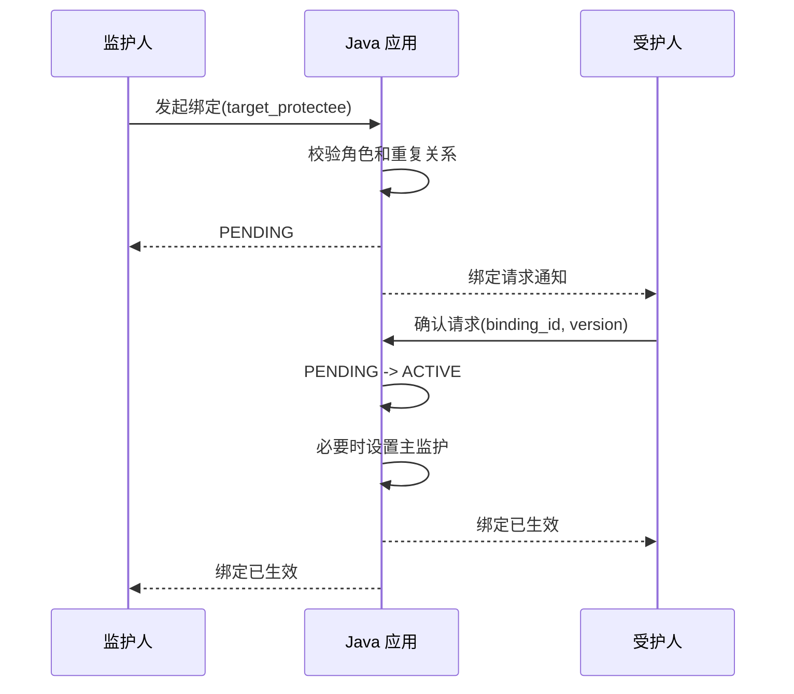
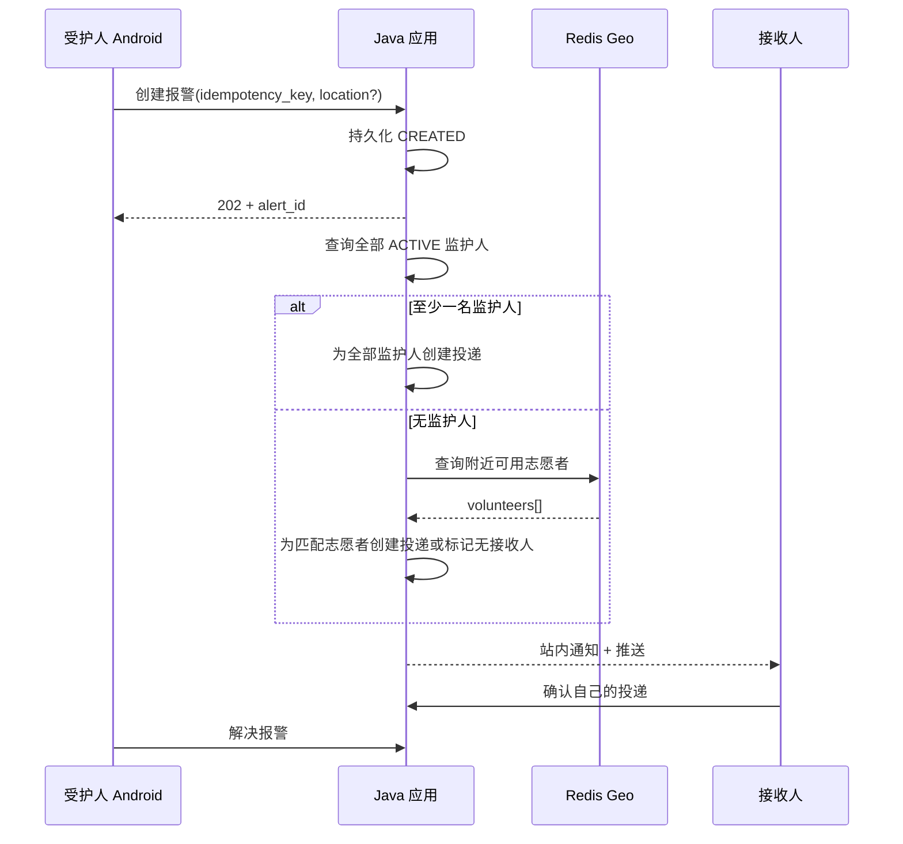

# SullivanMINI 用例与业务流程

**文档版本:** v1.0  
**基线日期:** 2026-07-26  
**适用范围:** SullivanMINI `[MINI]`

## 1. 用例约定

本文描述当前版本的端到端行为。所有用例均受以下共同条件约束:

- 除注册、登录和公开浏览外，参与者已登录且账号为 `ENABLED`。
- 服务端从 JWT 获取主体和角色，不信任客户端提交的拥有者字段。
- 状态名称和转换以 `02-术语枚举与状态机.md` 为准。
- 行级权限以 `03-角色权限与数据范围.md` 为准。
- 写请求携带 `trace_id`；报警等关键创建请求还携带客户端幂等键。
- 业务关联由统一数据库约束完整性，并由 Java 应用校验角色、状态和行级权限。
- 业务异常使用 `400/401/403/404/409/429/503` 等明确结果，不以 HTTP 200 包装失败。

## 2. 用例总览

| 用例 | 名称 | 主要参与者 | 对应需求 |
|---|---|---|---|
| UC-01 | 自然人注册与登录 | 受护人、监护人、志愿者 | FR-01, FR-02, FR-03 |
| UC-02 | 监护绑定请求与确认 | 监护人、受护人 | FR-04, FR-05 |
| UC-03 | 位置上报与监护查看 | 受护人、监护人 | FR-06 |
| UC-04 | 全景分割辅助导航 | 受护人 | FR-07, FR-08, FR-09, FR-10 |
| UC-05 | 安全报警与接收人路由 | 受护人、监护人、志愿者 | FR-11, FR-12, FR-13, FR-14, FR-21 |
| UC-06 | 公益机构注册与审核 | 公益机构、管理员 | FR-15, FR-22, FR-24 |
| UC-07 | 发布免费公益服务 | 公益机构 | FR-16 |
| UC-08 | 申请和处理公益服务 | 受护人、监护人、公益机构 | FR-17, FR-18 |
| UC-09 | 发布和管理公益活动 | 公益机构 | FR-19 |
| UC-10 | 志愿者报名与审核 | 志愿者、公益机构 | FR-20 |
| UC-11 | 通知与已读处理 | 全部业务主体 | FR-14 |
| UC-12 | 管理治理与运营统计 | 管理员 | FR-22, FR-23, FR-24 |

## 3. UC-01 自然人注册与登录

| 项目 | 内容 |
|---|---|
| 参与者 | 受护人、监护人、志愿者 |
| 触发 | 用户从 Android 三角色入口或 Web 对应入口选择注册/登录 |
| 前置条件 | 未登录；客户端可连接 Java 应用 |
| 后置条件 | 注册成功产生单一角色账号；登录成功产生有效令牌 |

### 3.1 主流程

1. 用户选择 `PROTECTEE`、`GUARDIAN` 或 `VOLUNTEER` 入口。
2. 用户填写账号、密码和该角色必填资料。
3. 客户端仅做格式预校验，将角色和资料提交 Java 应用。
4. 服务端校验账号唯一性、密码策略、角色白名单和资料格式。
5. 服务端在一个本地事务中创建账号与角色扩展资料，状态为 `ENABLED`。
6. 用户提交账号和密码登录。
7. 服务端验证凭据和账号状态，签发 JWT 与刷新令牌。
8. 客户端依据令牌中的服务端角色进入对应首页。

### 3.2 异常流程

- A1 账号重复: 第 4 步返回 `409`，不创建任何角色扩展记录。
- A2 非法角色: 返回 `400`；不能通过请求体注册机构或管理员。
- A3 受护人未填写监护人: 不视为异常，继续注册。`primary_guardian` 为空。
- A4 密码错误: 返回统一 `401`，不说明账号是否存在。
- A5 账号禁用: 返回 `403`，不签发令牌。
- A6 入口与账号角色不同: 服务端拒绝该入口要求的角色能力，客户端提示切换正确入口。
- A7 注册事务部分失败: 整体回滚，不保留无扩展资料的半成品账号。

### 3.3 验收场景

1. 无监护人的新受护人能注册、登录并进入受护人 Android 首页。
2. Android 三个入口分别只能到达匹配角色功能。
3. Web 可由监护人和志愿者登录，但不显示受护人导航入口。
4. 修改请求中的角色或主体 ID 不能获得额外权限。

## 4. UC-02 监护绑定请求与确认

| 项目 | 内容 |
|---|---|
| 参与者 | 监护人、目标受护人 |
| 触发 | 监护人输入受护人 UID 或已验证手机号发起绑定 |
| 前置条件 | 双方账号可用；角色分别为监护人和受护人 |
| 后置条件 | 受护人确认后关系 `ACTIVE`；否则不授予监护权限 |

### 4.1 主流程

1. 监护人提交目标标识和关系说明。
2. Java 绑定模块查找目标并验证其受护人角色。
3. 服务端检查双方不存在 `PENDING` 或 `ACTIVE` 重复关系。
4. 服务端创建 `PENDING` 绑定，记录发起人、目标和 7 天过期时间。
5. 系统为目标受护人创建 `BINDING_REQUEST` 通知。
6. 受护人在 Android 查看请求中的监护人最小必要资料。
7. 受护人选择确认。
8. 服务端以资源版本执行条件更新，将 `PENDING` 改为 `ACTIVE` 并写入 `activated_at`。
9. 若受护人没有其他主监护关系，将本关系设为 `is_primary=true`。
10. 系统通知双方绑定结果。此后监护人获得本关系对应的位置查看、报警接收和代申请权限。

### 4.2 分支与异常流程

- B1 受护人拒绝: 第 7 步选择拒绝，状态变为 `REJECTED`，不赋权并通知发起人。
- B2 监护人取消: 在受护人处理前，发起人将 `PENDING` 改为 `CANCELLED`。
- B3 请求过期: 创建 7 天后仍为 `PENDING`，定时任务改为 `EXPIRED`；之后确认返回 `409`。
- B4 目标不存在或角色不符: 返回 `404` 或统一不可绑定结果，不泄露无关账户资料。
- B5 重复请求: 已有 `PENDING/ACTIVE` 时返回 `409`，不创建第二条有效关系。
- B6 并发确认和取消: 只有一个基于 `PENDING` 的条件更新成功，另一请求返回当前状态和 `409`。
- B7 非目标受护人确认: 返回 `403`。
- B8 解除关系: 任一关系方将 `ACTIVE` 改为 `TERMINATED`，权限立即失效。
- B9 解除主监护: 同一事务内按 `activated_at, id` 提升最早其他 `ACTIVE` 关系；没有则主监护为空。

### 4.3 业务时序

### 4.4 验收场景

1. 待确认监护人查询受护人位置返回 `403`；确认后成功。
2. 同一受护人可确认多个监护人，且最多一条生效关系为主监护。
3. 解除后使用旧页面再次读取位置返回 `403`。
4. 管理员不能代替受护人确认请求。

## 5. UC-03 位置上报与监护查看

| 项目 | 内容 |
|---|---|
| 参与者 | 受护人、已绑定监护人 |
| 前置条件 | 受护人授予定位权限；查看方与受护人存在 `ACTIVE` 关系 |
| 后置条件 | Redis Geo 保存最新位置；监护人看到坐标和采集时间 |

### 5.1 主流程

1. 受护人开启位置共享或导航，Android 获取定位。
2. Android 上报经纬度、精度和设备采集时间，上报间隔目标不大于 10 秒。
3. Java 位置模块验证令牌主体等于 `protectee_uid`，校验坐标和时间。
4. 服务将最新位置及时间写入 Redis，必要时异步记录业务审计。
5. 监护人选择一名已绑定受护人查看位置。
6. Java 应用查询统一数据库或带版本的短缓存，校验 `ACTIVE` 关系。
7. 服务返回最新位置、采集时间、精度和是否过期。
8. Web 或 Android 地图展示位置；超过 30 秒显著标识过期。

### 5.2 异常流程

- C1 定位权限拒绝: Android 显示授权说明，停止上报；报警仍可创建。
- C2 坐标非法或时间明显在未来: 返回 `400`，不覆盖上一有效位置。
- C3 无缓存位置: 返回明确的“暂无位置”，不返回默认坐标。
- C4 位置过期: 返回最后位置及 `stale=true`，界面显示最后更新时间。
- C5 无生效绑定: 返回 `403`，即使监护人曾经绑定或持有旧缓存。
- C6 数据库暂不可用且无法确认关系: 拒绝敏感读取并返回 `503`，不得默认授权。

### 5.3 验收场景

1. 两名生效监护人均能查看，第三名未确认监护人不能查看。
2. 关系解除后权限立即失效。
3. 管理员和志愿者不能通过普通接口读取受护人位置。

## 6. UC-04 全景分割辅助导航

| 项目 | 内容 |
|---|---|
| 参与者 | 受护人 Android 用户 |
| 触发 | 用户通过按钮或语音启动导航 |
| 前置条件 | 已登录；摄像头可用；导航服务可连接 |
| 后置条件 | Android 持续播报有效引导，或进入明确安全降级状态 |

### 6.1 主流程

1. 受护人启动导航，Android 请求摄像头权限并创建导航会话。
2. Python 导航应用验证 `PROTECTEE` 角色，创建 `ACTIVE` 会话。
3. Android Camera2 按目标频率采集并压缩帧，附会话 ID 和递增帧序号上传。
4. 导航服务校验图像格式、大小、会话拥有者和会话状态。
5. 模型完成全景分割，输出类别、掩码/边界和置信度。
6. 空间分析计算方位、相对距离和可用的运动趋势。
7. 规则层选取最高风险目标，生成 `risk_level` 与简短 `guide_text`。
8. 服务返回帧序号、障碍物摘要、引导文本和处理时间，并异步记录导航日志。
9. Android 丢弃迟到的旧帧结果，按优先级将文本提交系统本地 `TextToSpeech`。
10. 用户停止导航，Android 清空非报警播报队列并将会话转为 `STOPPED`。

### 6.2 播报规则

- `DANGER` 立即播报，可中断 `SAFE/CAUTION`。
- 相同普通提示且场景无显著变化时至少间隔 2 秒。
- `UNKNOWN` 使用“无法确认前方情况，请停下并确认环境”等保守提示。
- 服务端只返回文字，不生成音频；音量、语速和语音包由 Android 本地控制。

### 6.3 异常流程

- D1 摄像头或权限不可用: 不创建/终止会话，显示并朗读无法导航。
- D2 输入超限: 单帧返回 `400/413`；客户端按配置降低尺寸或频率，不能无限重试原帧。
- D3 服务限流: 返回 `429`；客户端降帧并提示性能下降。
- D4 网络超时或连续丢帧: 停止复用旧的 `SAFE` 结果，播报导航暂不可用。
- D5 置信度低: 返回 `UNKNOWN` 或保守 `CAUTION`，不得返回确定安全结论。
- D6 模型异常: 会话可转 `FAILED`，记录错误标识，不把堆栈返回客户端。
- D7 TTS 初始化失败: Android 使用高对比文字和震动，提供重试；后端不代为合成音频。
- D8 结果乱序: 帧序号小于客户端最近已处理序号时丢弃。
- D9 语音识别不确定: 要求用户确认；“报警”必须走 UC-05，不能只在本地提示。

### 6.4 验收场景

1. 基准环境达到有效处理不低于 10 FPS、服务端推理 `P95 <= 150 ms`、端到端 `P95 <= 500 ms`。
2. 对车辆、行人、台阶、路障、坡道和柱子等测试集输出类别与风险提示。
3. 断网时客户端不会继续播报旧的“前方安全”。
4. 服务端响应和对象存储中不存在导航 TTS 音频。
5. TalkBack 可读启动、停止、报警和当前导航状态。

## 7. UC-05 安全报警与接收人路由

| 项目 | 内容 |
|---|---|
| 主要参与者 | 受护人 |
| 次要参与者 | 全部生效监护人，或无监护人时的附近可用志愿者 |
| 触发 | 受护人点击报警按钮或确认语音报警指令 |
| 前置条件 | 受护人已登录；位置可有可无；绑定可有可无 |
| 后置条件 | 报警持久化，接收人集合按互斥规则固化，逐人投递可追踪 |

### 7.1 创建和路由主流程

1. Android 生成 `idempotency_key`，提交报警类型和可用的位置快照。
2. Java 报警模块验证受护人身份并先创建 `CREATED` 报警。
3. 服务返回报警 ID 和已受理状态，不等待外部推送完成。
4. 异步任务获取该报警，将状态条件更新为 `DISPATCHING`。
5. 任务在同一数据库事务中查询报警创建时全部 `ACTIVE` 监护关系。
6. 若监护人数量大于 0，设置路由为 `ALL_GUARDIANS`，为每一名监护人创建唯一 `PENDING` 投递。
7. 若监护人数量为 0，查询 `is_available=true`、位置不超过 30 秒且在配置半径内的志愿者。
8. 有合格志愿者时设置路由为 `NEARBY_VOLUNTEERS`，为选中志愿者分别创建投递；没有则设置 `NONE` 并将报警标记 `NO_RECIPIENT`。
9. 对每条投递创建站内 `ALERT` 通知并调用推送通道，独立更新 `SENT/DELIVERED/FAILED`。
10. 有接收人进入发送流程后，报警状态为 `DISPATCHED`。
11. 接收人打开报警并主动确认，仅将自己的投递转为 `ACKNOWLEDGED`；报警聚合状态转为 `ACKNOWLEDGED`。
12. 受护人确认危险解除，将报警转为 `RESOLVED`；全部记录保留。

### 7.2 路由决策表

| 创建时生效监护人数 | 合格附近志愿者 | 路由 | 接收人 |
|---:|---:|---|---|
| `>= 1` | 任意 | `ALL_GUARDIANS` | 全部生效监护人 |
| `0` | `>= 1` | `NEARBY_VOLUNTEERS` | 匹配出的附近可用志愿者 |
| `0` | `0` | `NONE` | 无，状态 `NO_RECIPIENT` |

### 7.3 业务时序

### 7.4 异常流程

- E1 无位置: 正常创建并路由；通知明确“位置不可用”，不阻塞报警。
- E2 重复点击或网络重试: 相同受护人和幂等键返回同一报警，不重复投递。
- E3 查询监护关系暂时失败: 保持可重试状态并记录错误，不能未经确认直接广播志愿者。
- E4 有监护人但推送均失败: 路由仍为 `ALL_GUARDIANS`，逐条重试；达到上限后 `DISPATCH_FAILED`，不广播志愿者。
- E5 无监护人且没有附近志愿者: 转 `NO_RECIPIENT`，客户端持续显示未找到接收人，保留人工求助提示。
- E6 志愿者位置过期或已关闭可服务: 不进入候选集合。
- E7 一名监护人确认: 只更新该监护人投递，其他监护人投递状态不被覆盖。
- E8 报警后新增或解除绑定: 不改写已固化接收人；解除关系不再开放持续位置。
- E9 非所属受护人解决报警: 返回 `403`。

### 7.5 验收场景

1. 受护人有 3 名生效监护人时产生 3 条监护人投递，志愿者投递为 0。
2. 有监护人但 3 条推送均模拟失败时，仍无志愿者投递。
3. 无生效监护人时只投递给半径内、位置新鲜且主动可服务的志愿者。
4. 无位置仍可创建报警；重复请求仅一条报警。
5. 志愿者不能查看未投递给自己的报警或受护人历史位置。

## 8. UC-06 公益机构注册与审核

| 项目 | 内容 |
|---|---|
| 参与者 | 公益机构、有 `ORG_REVIEW` 权限的管理员 |
| 前置条件 | 机构未注册；管理员账号可用 |
| 后置条件 | 机构为 `APPROVED`、`REJECTED` 或保持待审核 |

### 8.1 主流程

1. 机构在 Web 提交账号、机构名称、类型、简介、联系方式和审核材料。
2. 服务创建机构账号和 `PENDING` 机构记录。
3. 管理员查看待审核列表和必要材料。
4. 管理员选择通过，填写审核意见。
5. 服务验证 `ORG_REVIEW` 权限，将 `PENDING` 转为 `APPROVED`，记录操作者和前后状态。
6. 系统向机构创建 `ORG_REVIEW` 通知。
7. 机构可开始发布服务项目和活动。

### 8.2 异常流程

- F1 资料不完整: 返回 `400`，不创建半成品业务记录。
- F2 审核拒绝: 原因必填，状态转 `REJECTED`；机构可修改资料后重新提交为 `PENDING`。
- F3 管理员无权限: 返回 `403`，不写审核记录。
- F4 并发审核: 只有首个基于版本的状态转换成功，后续返回 `409`。
- F5 已认证机构被禁用: 状态转 `DISABLED`，停止新申请和报名；恢复后回到 `PENDING` 重新审核。

### 8.3 验收场景

1. `PENDING/REJECTED/DISABLED` 机构均不能发布。
2. 拒绝和禁用都记录原因，但语义和后续转换不同。
3. 审核记录包含管理员 ID、时间、意见、前后状态和 `trace_id`。

## 9. UC-07 发布免费公益服务

| 项目 | 内容 |
|---|---|
| 参与者 | 已认证公益机构 |
| 前置条件 | 机构状态为 `APPROVED` |
| 后置条件 | 产生 `OPEN` 项目，供受护人和监护人浏览 |

### 9.1 主流程

1. 机构填写名称、说明、配图和名额策略。
2. 服务校验名称、描述、名额及机构状态。
3. 服务以令牌机构 ID 作为项目所有者，忽略客户端伪造所有者。
4. 项目创建为 `OPEN`，公开列表可见并明确“免费”。
5. 机构可将项目 `OPEN -> PAUSED -> OPEN`，或从开放/暂停永久转为 `CLOSED`。

### 9.2 异常流程

- G1 有限名额小于 0: 返回 `400`；无限名额使用明确的无限标志或约定值。
- G2 机构未认证或被禁用: 返回 `403`。
- G3 修改其他机构项目: 返回 `403`。
- G4 关闭后重新开放: 返回 `409`。
- G5 图片存储失败: 可保存无图项目或返回可重试错误，不得丢失已提交文字；具体策略需保持接口一致。
- G6 请求包含价格或支付字段: 返回 `400` 或忽略非白名单字段，界面不展示收费信息。

### 9.3 验收场景

1. MINI 项目模型、接口和页面无价格、订单、支付入口。
2. 暂停/关闭项目不删除历史申请。
3. 公开列表仅显示 `APPROVED` 机构的 `OPEN` 项目。

## 10. UC-08 申请和处理公益服务

| 项目 | 内容 |
|---|---|
| 参与者 | 受护人、监护人、项目所属机构 |
| 前置条件 | 项目 `OPEN`；机构 `APPROVED` |
| 后置条件 | 申请按 `PENDING -> APPROVED -> COMPLETED`，或进入拒绝/取消终态 |

### 10.1 受护人自行申请

1. 受护人浏览开放项目并选择申请。
2. 客户端提交项目 ID 和备注，申请人及受益人均取当前受护人。
3. Java 公益模块校验关联主体、项目状态、机构状态和重复有效申请。
4. 服务创建 `PENDING` 申请并通知所属机构。
5. 机构查看本机构项目申请并选择批准。
6. 服务在事务内原子校验剩余名额，将申请改为 `APPROVED`。
7. 服务通知申请人。
8. 服务完成后，机构将 `APPROVED` 改为 `COMPLETED` 并通知申请人。

### 10.2 监护人代申请

1. 监护人从自己的 `ACTIVE` 受护人列表选择受益人。
2. 客户端提交项目和受益受护人 ID。
3. Java 应用在同一事务中校验当前生效绑定。
4. 申请记录保存 `applicant=监护人` 和 `beneficiary=受护人`，后续同主流程第 4 步。

### 10.3 异常流程

- H1 监护关系待确认、过期或已解除: 代申请返回 `403`。
- H2 重复有效申请: 同一受益人和项目已有 `PENDING/APPROVED` 时返回 `409`。
- H3 项目暂停/关闭或机构被禁用: 拒绝新申请，历史申请保留。
- H4 申请人取消: `PENDING -> CANCELLED`；机构随后批准返回 `409`。
- H5 机构拒绝: `PENDING -> REJECTED`，拒绝原因必填并通知。
- H6 名额竞争: 最后一个名额只能有一个并发批准成功，其余返回 `409`。
- H7 其他机构处理: 返回 `403`。
- H8 重复完成: 返回当前 `COMPLETED`，不重复通知或改变名额。

### 10.4 验收场景

1. 受护人无监护人仍能自行申请。
2. 两个监护人可查看自己代申请记录，但只有当前生效关系可继续读取受益详情。
3. 申请全流程无金额、订单或支付步骤。
4. 有限名额在并发批准下不超卖。

## 11. UC-09 发布和管理公益活动

| 项目 | 内容 |
|---|---|
| 参与者 | 已认证公益机构、系统定时任务 |
| 前置条件 | 机构 `APPROVED`；开始时间晚于当前，结束时间晚于开始时间 |
| 后置条件 | 活动依时间进入 `RECRUITING/IN_PROGRESS/ENDED`，或被取消 |

### 11.1 主流程

1. 机构填写标题、说明、地点、开始时间、结束时间和人数上限。
2. 服务校验字段并以令牌机构作为所有者。
3. 服务创建 `RECRUITING` 活动。
4. 到达开始时间，定时任务以条件更新转为 `IN_PROGRESS`。
5. 到达结束时间，定时任务转为 `ENDED`。
6. 每次影响参与者的状态变化创建通知。

### 11.2 异常流程

- I1 时间非法或人数不大于 0: 返回 `400`。
- I2 未认证机构发布: 返回 `403`。
- I3 开始前取消: `RECRUITING -> CANCELLED`，通知全部已报名志愿者。
- I4 进行中紧急取消: 原因必填，转 `CANCELLED` 并通知参与者。
- I5 定时任务重复运行: 条件更新幂等，不重复发送同一状态通知。
- I6 其他机构修改: 返回 `403`。

### 11.3 验收场景

1. 只有 `RECRUITING` 可报名。
2. 活动结束仅改变状态和通知，不创建群聊或消息集合。
3. 活动页面明确公益免费，不出现票价和支付。

## 12. UC-10 志愿者报名与审核

| 项目 | 内容 |
|---|---|
| 参与者 | 志愿者、活动所属机构 |
| 前置条件 | 活动 `RECRUITING`；志愿者账号可用 |
| 后置条件 | 报名为 `APPROVED`、`REJECTED` 或 `CANCELLED` |

### 12.1 主流程

1. 志愿者浏览招募中活动并点击报名。
2. 服务校验志愿者角色、活动状态和无重复非取消报名。
3. 服务创建 `PENDING` 报名并通知活动所属机构。
4. 机构查看自己活动的待审核报名。
5. 机构批准报名，服务原子校验已批准人数小于上限。
6. 报名转 `APPROVED`，系统通知志愿者。

### 12.2 异常流程

- J1 重复报名: 返回 `409`。
- J2 活动已开始、结束或取消: 返回 `409`。
- J3 人数已满: 批准返回 `409`，报名保持 `PENDING` 供机构拒绝或候补处理；MINI 不自动创建候补状态。
- J4 机构拒绝: 转 `REJECTED` 并通知。
- J5 志愿者开始前取消: `PENDING/APPROVED -> CANCELLED`，已批准名额释放。
- J6 其他机构审核: 返回 `403`。
- J7 两名机构操作员并发批准最后名额: 仅一个事务成功。

### 12.3 验收场景

1. 报名者不能查看其他报名者清单。
2. 机构只查看自己活动的报名和必要联系资料。
3. 取消已批准报名会释放活动名额。

## 13. UC-11 通知与已读处理

| 项目 | 内容 |
|---|---|
| 参与者 | 自然人、机构、管理员 |
| 前置条件 | 业务事件已创建通知 |
| 后置条件 | 接收人读取通知；可选推送状态可追踪 |

### 13.1 主流程

1. Java 业务模块在状态事务成功后，以本地可靠任务创建通知。
2. 通知保存接收主体类型、接收主体 ID、类型、标题、内容和业务引用。
3. 推送任务调用外部通道并记录结果，不影响站内通知持久化。
4. 接收人查询列表，服务使用主体类型和 ID 双条件过滤并分页。
5. 接收人打开通知，将自己的 `UNREAD` 改为 `READ`。

### 13.2 异常流程

- K1 推送失败: 站内通知仍可见，任务按配置重试。
- K2 重复业务事件: 以业务引用和通知类型去重，不产生重复通知。
- K3 标记他人通知: 返回 `403` 或一致的 `404`。
- K4 重复标记已读: 幂等返回 `READ`，未读数不出现负数。
- K5 报警通知已读: 不自动等同 `ALERT_DELIVERY.ACKNOWLEDGED`；接收人须执行明确确认操作。

## 14. UC-12 管理治理与运营统计

| 项目 | 内容 |
|---|---|
| 参与者 | `SUPER_ADMIN`、有授权的 `OPERATIONS` |
| 前置条件 | 管理员已登录并具有目标权限代码 |
| 后置条件 | 治理状态正确改变并审计，或返回不含敏感明细的统计结果 |

### 14.1 治理主流程

1. 管理员进入与权限匹配的用户或机构列表。
2. 服务先按权限过滤，再返回脱敏数据。
3. 管理员选择禁用、恢复或审核操作并填写原因。
4. 服务重新校验权限、资源版本和当前状态。
5. 服务执行状态转换，记录操作者、对象、原因、前后值、时间和 `trace_id`。
6. 对受影响主体创建通知。

### 14.2 统计主流程

1. 有 `OPERATION_STATS` 权限的管理员选择统计时间窗。
2. 服务按统一状态口径聚合用户数、认证机构数、服务申请数、报警数和志愿活动数据。
3. 响应包含统计窗口、生成时间、指标值和空数据的 0 值。
4. Web 展示聚合结果和数据更新时间，不展示不必要的个人明细。

### 14.3 异常流程

- L1 权限不足: 返回 `403`，不返回部分数据。
- L2 非法状态转换: 返回 `409`，例如将 `DISABLED` 机构直接恢复为 `APPROVED`。
- L3 并发治理: 版本较旧的操作返回 `409`。
- L4 统计依赖失败: 返回明确不可用或带新鲜度的缓存结果，不伪造数据。
- L5 管理员尝试查看实时位置、密码或导航原始帧: 返回 `403`。
- L6 普通管理员分配权限: 返回 `403`；只有 `SUPER_ADMIN` 可执行。

## 15. 跨流程一致性规则

1. **绑定与位置:** 只有 `ACTIVE` 关系授权位置；`PENDING`、拒绝、过期和终止均不授权。
2. **绑定与报警:** 报警路由读取创建时全部 `ACTIVE` 关系并固化，主监护不排除其他监护人。
3. **报警与志愿者:** 只有生效监护人为零才查志愿者；推送失败不等于无监护人。
4. **机构状态与业务:** 机构非 `APPROVED` 时停止发布、新申请和新报名，历史申请、报名和通知保留。
5. **名额:** 服务名额由 `APPROVED + COMPLETED` 申请占用；活动名额由 `APPROVED` 报名占用，均须原子更新。
6. **免费:** MINI 的项目、申请、活动和报名不得派生订单、支付、退款、钱包或结算。
7. **TTS:** 导航服务生成文本，Android 本地合成语音；通知服务不承担导航 TTS。
8. **业务关联:** 单库外键保护存在性，Java 写入前仍校验角色、状态和权限；失败时整体回滚。
9. **审计:** 绑定、审核、申请、报名、报警和权限变化保留历史，不通过物理删除掩盖状态。
10. **`[FULL]` 隔离:** AI 客服、聊天、视频、商业交易等 `[FULL]` 能力不出现在当前主流程、菜单或验收统计。

## 16. 端到端验收最小集合

| 场景编号 | 场景 | 通过条件 |
|---|---|---|
| E2E-01 | 受护人独立注册 | 无监护人字段也能注册登录 |
| E2E-02 | 绑定确认前后权限 | 确认前位置 `403`，确认后可读，解除后再次 `403` |
| E2E-03 | 多监护人报警 | 全部生效监护人各有投递，无志愿者投递 |
| E2E-04 | 无监护人报警 | 仅附近、可用且位置新鲜的志愿者收到投递 |
| E2E-05 | 监护人推送失败 | 重试并记录失败，不切换志愿者路由 |
| E2E-06 | 导航成功 | 服务返回文本，Android 本地 TTS 播报，达到基准性能 |
| E2E-07 | 导航断网 | 不复用旧安全结论，进入保守降级 |
| E2E-08 | 监护人代申请 | 仅能为生效绑定受护人申请，机构完成闭环 |
| E2E-09 | 服务名额竞争 | 最后一个名额并发批准不超额 |
| E2E-10 | 活动报名竞争 | 批准人数不超过上限，取消释放名额 |
| E2E-11 | 机构越权 | 机构不能处理其他机构申请和报名 |
| E2E-12 | 客户端覆盖 | Android 三角色及 Web 四角色核心入口可用 |
| E2E-13 | 公益免费 | 页面、接口和数据中无价格、支付、订单、钱包 |
| E2E-14 | `[FULL]` 隔离 | 商业、AI 客服、聊天和视频入口不可用且不计完成度 |
