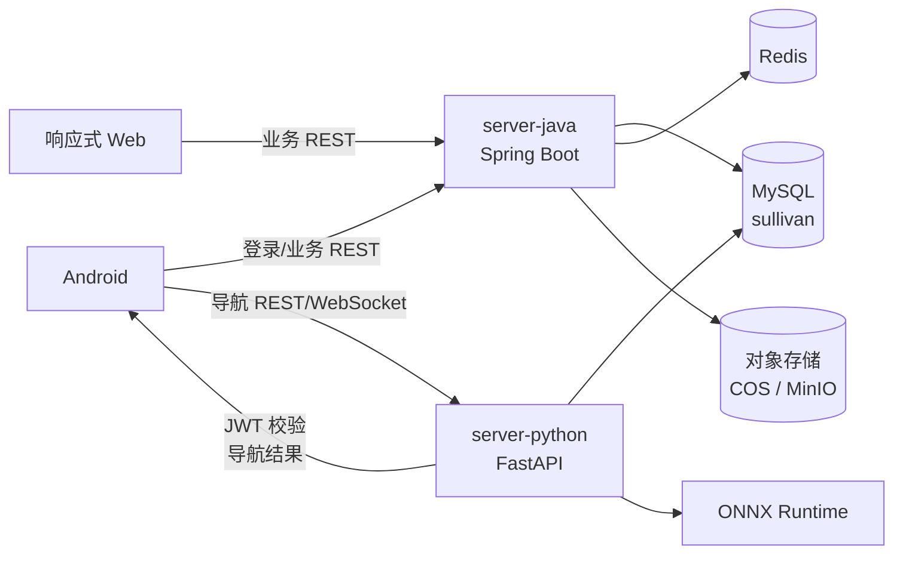

# SullivanMINI 系统架构设计

**文档版本:** v2.0  
**编制日期:** 2026-08-04  
**适用范围:** SullivanMINI `[MINI]`

## 1. 架构结论

MINI 采用**双应用架构**，不采用微服务架构：

| 部分 | 运行进程 | 职责 | 对外端口 |
|---|---|---|---:|
| Java 部分 | `server-java` | 统一 API、登录鉴权、用户绑定、位置、报警、公益、管理、通知 | 8080 |
| Python 部分 | `server-python` | 全景分割、空间分析、风险判断、引导文本、导航会话与帧通道 | 8000 |

Java 是业务系统的唯一入口和主数据写入方。Python 只负责导航领域的计算，并通过约定的 HTTP/WebSocket 接口向 Android 提供导航结果。两部分不是一组可独立部署、独立扩容的微服务集合，而是一个项目中的两个技术栈边界。

明确取消：API Gateway、Spring Cloud、Nacos、Feign、服务注册发现、按服务拆分数据库、跨服务消息总线和 Java 多模块服务集群。

## 2. 请求与数据流

- Android 和 Web 的账号、绑定、位置、报警、公益和管理请求直接访问 Java。
- Android 的导航帧直接访问 Python，避免 Java 处理高频图像帧。
- Java 与 Python 使用同一 JWT 签名配置；Python 只接受 `PROTECTEE` 的导航请求，并校验会话归属。
- MySQL 只有一个 `sullivan` 数据库。Java 负责除导航运行数据之外的全部业务写入；Python 只写入 `model_version`、`navigation_session` 和 `navigation_sample_event`。
- Redis 只存位置、附近匹配、幂等键和短时权限缓存；对象存储只存机构材料、业务图片与语音留言音频。

## 3. Java 部分

Java 采用模块化单体，模块只代表代码边界，不代表独立服务：

| 模块 | 内容 |
|---|---|
| `identity` | 注册、登录、JWT、刷新令牌、角色资料 |
| `relationship` | 监护绑定、位置授权、位置查询 |
| `alert` | 报警、接收人路由、通知、重试任务 |
| `welfare` | 机构、免费服务、申请、活动、报名 |
| `admin` | 管理员、RBAC、审核、统计、审计 |
| `shared` | ULID、异常、时间、分页、统一响应、幂等 |

模块之间通过 Java 方法调用和同一事务协作，不使用内部 HTTP。事务状态、权限和名额并发在一个 Spring 事务中完成，避免分布式事务与跨进程一致性问题。

## 4. Python 部分

Python 保持独立进程，原因是模型训练、图像预处理、OpenCV、NumPy 和 ONNX Runtime 生态集中在 Python。它只暴露导航接口：

- `POST /api/v1/navigation/sessions` 创建会话。
- `POST /api/v1/navigation/analyze-frame` 作为单帧降级和测试接口。
- WebSocket 作为连续帧主通道。
- `POST /api/v1/navigation/sessions/{id}/stop` 停止会话。
- `/actuator/health` 提供健康检查。

Python 不承担用户注册、通用权限、公益业务、报警路由或通知发送，不调用 Java 内部接口，也不读取其他业务表。

## 5. 数据与一致性

1. 所有表位于 `sullivan` 数据库，由 Java Flyway 执行统一迁移。
2. 同一数据库内允许使用物理外键；不再使用“跨 schema 逻辑外键”作为架构约束。
3. Java 是 `user_account`、绑定、位置、公益、报警、通知和管理表的权威写入方。
4. Python 的导航会话只接受自己的 `PROTECTEE` JWT，并在写入前检查会话 ID 与令牌主体一致。
5. 所有关键状态变更仍使用 `version` 乐观锁；报警和通知使用本地 outbox 表加定时重试，不引入消息队列。

## 6. 安全边界

- Java 和 Python 都独立校验 JWT 签名、过期时间、主体类型和角色，不能把 Python 当作 Java 的信任代理。
- 外部客户端只访问两个明确端口；生产环境可由 Nginx/TLS 反向代理统一域名，但 Nginx 不是业务网关，也不承载服务发现或业务路由。
- Python 不接受客户端提交的任意 `protectee_uid` 作为权限依据，只使用令牌主体和会话记录。
- 管理员不因 Java 应用内的内部模块边界而获得额外数据权限。

## 7. 部署原则

开发环境启动 MySQL、Redis，媒体存储用本地文件系统（`app.media.store=filesystem`，不必起 MinIO），然后在 IDE 或 Compose 中启动 `server-java` 和 `server-python`。不启动 Nacos，不配置服务注册中心，不维护多套 schema。

生产环境最小部署单元为：一个 Java 容器、一个 Python 容器、一个 MySQL、一个 Redis；媒体对象存腾讯云 COS（`app.media.store=cos`），因此**不自建 MinIO**——对象存储由云服务承担，少一个要自己保证冗余与备份的组件。若部署环境不允许出公网，再改用自建 MinIO（`app.media.store=minio`）。Python 推理实例是否增加由帧处理基准决定，不以“拆服务”为前提。

## 8. 取消项核对

| 取消项 | 替代方案 |
|---|---|
| `api-gateway` | Java 应用直接提供统一 `/api` 入口 |
| 原用户、公益、管理、报警拆分 | Java 模块化单体 |
| Nacos/服务发现 | 环境变量配置固定地址 |
| OpenFeign/内部服务调用 | Java 方法调用；Java-Python 只保留导航协议 |
| 四个独享 schema | 一个 `sullivan` 数据库 |
| 跨服务消息总线 | Java 本地 outbox + `@Scheduled` |
